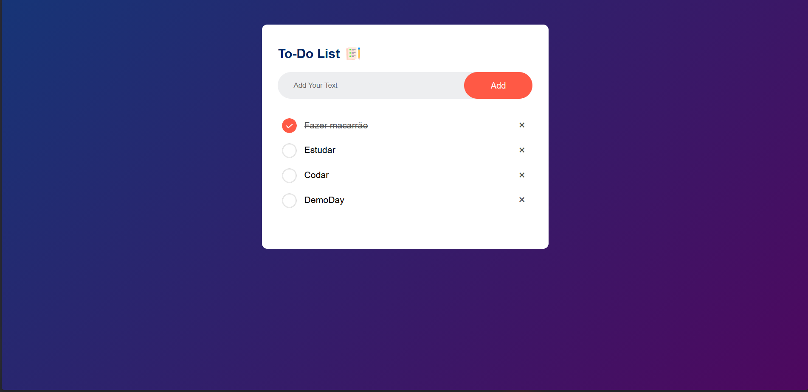

# To-Do List

Uma aplicação simples de lista de tarefas desenvolvida com HTML, CSS e JavaScript.

O objetivo deste projeto é permitir que o usuário adicione tarefas, marque as concluídas e remova itens da lista de forma rápida e intuitiva. Além disso, as tarefas ficam salvas no navegador usando `localStorage`, então a lista continua disponível mesmo após recarregar a página.

## Visual



## 📌 Sobre o projeto

Este é um projeto didático de JavaScript, pensado para praticar:

- manipulação do DOM
- eventos de clique
- criação dinâmica de elementos
- armazenamento local no navegador
- lógica de interface para aplicações web simples

## ✨ Funcionalidades

- Adicionar uma nova tarefa digitando no campo de texto
- Marcar tarefas como concluídas ao clicar nelas
- Remover tarefas da lista com o botão de exclusão
- Persistência das tarefas no navegador com `localStorage`
- Layout moderno e responsivo, com estilo visual limpo e agradável

## 🧩 Estrutura do projeto

```text
projeto06-todolist/
├── index.html
├── style.css
├── script.js
├── img/
│   ├── checked.png
│   ├── unchecked.png
│   └── icon.png
└── README.md
```

## ▶️ Como executar

1. Abra a pasta do projeto no seu editor de código.
2. Localize o arquivo `index.html`.
3. Abra-o em um navegador.

Você também pode usar uma extensão como Live Server no VS Code para uma experiência mais prática.

## 🛠️ Tecnologias utilizadas

- HTML5
- CSS3
- JavaScript

## 🧠 Como funciona

- O usuário digita uma tarefa no campo de entrada.
- Ao clicar em "Add", a tarefa é adicionada à lista.
- Clicando sobre a tarefa, ela recebe um estilo de concluída.
- Clicando no botão de exclusão (`×`), a tarefa é removida.
- Todo o estado da lista é salvo automaticamente no `localStorage`.

## 📎 Observações

Este projeto é ideal para quem está começando em JavaScript, porque mostra como criar uma aplicação interativa sem a necessidade de frameworks ou bibliotecas.

---

<p align="center">
  Desenvolvido por <a href="https://github.com/LucMNS"><b>LucMNS</b></a>
</p>